# Cơ Tiên — bida × tu tiên

Game bida cho điện thoại (màn hình ngang) và máy tính, với vật lý và luật bida thật, đặt trong một thế giới
tiên hiệp riêng: **Cơ Tiên Giới** — 13 môn phái, 65 tướng, mỗi tướng có nội tại và 3 chiêu. Cài được như ứng
dụng (PWA), chơi offline.

**Chơi ngay:** https://cotien.khoinda.vn/

## Tính năng

- **Bida thật**
  - 8 bi, 9 bi, 10 bi theo luật WPA 2026 (push-out, 3 lỗi liên tiếp, luật phá 3 bi, quyền chọn sau phá
    không hợp lệ, gọi bi gọi lỗ) và bi-a phăng tự do, 3 băng theo UMB.
  - Kích thước chuẩn WPA: bàn 7 ft, bi 57,15 mm, miệng lỗ góc 117,5 mm và lỗ giữa 130 mm, hàm lỗ 142°/104°.
  - Vật lý: ma sát trượt và lăn, spin ba trục, throw, squirt, áp phê đổi góc bật băng, phá bi bảo toàn năng
    lượng. Cú nhảy dùng góc nâng cơ, lực và điểm chạm trong mô hình 2.5D; nâng cao cần đánh gần tâm hơn, bi có thể văng bàn. Màu bi theo bộ Aramith truyền thống, vẽ bằng shader và lăn theo vận tốc góc thật.
- **Hai chế độ cho mọi thể loại:** **Tiên Đạo** (chiêu, nội tại, địa thế) và **Cổ Điển** (bida thuần).
- **Chấm điểm cú đánh:** năng lượng tính theo độ khó và độ đẹp của cú (cắt mỏng, bi băng, hai băng, bi kết,
  gỡ băng, nhảy qua bi chặn, cú xa, ăn nhiều bi, ba băng); thông báo gọi tên cú đẹp. Lợi thế Ảnh Sát cần chuỗi
  ít nhất 4 bi đạt 5 điểm cú đánh.
- **Kết liễu:** cú đánh thắng ván (mọi thể loại) mở màn kết liễu riêng của từng tướng trong 65 tướng: tướng lao
  tới thúc cơ, bi quyết định bay theo vệt mực vào lỗ, dấu son “Kết liễu” kèm tên cú.
- **Địa thế:** mỗi môn phái có Linh Đài riêng (màu nỉ, ma sát, độ nảy băng, miệng lỗ) và Thiên Tượng ngẫu
  nhiên — bão tuyết, sóng lừng, gió giật, giếng sao, rễ cây… — đều là lực và ma sát thật trong mô phỏng,
  báo trước và vẽ lên bàn. Gió giữ một chiều suốt lượt, thông báo nêu hướng và sức gió (nhẹ, vừa, mạnh), mũi
  tên mực trên nỉ to và trôi nhanh theo sức gió. Địa Lợi cho tướng đánh trên bàn quê nhà.
- **Luận Cơ:** so tài nhanh với máy. **Song Đấu:** hai người luân phiên trên cùng một thiết bị; mỗi bên tự đặt
  tên, chọn tướng đã mở khoá (không trùng nhau) và cây cơ, cùng chọn bàn — không phụ thuộc tướng đại diện.
- **Luyện Cơ:** luyện từng cú đánh qua các bài thế có lời giải, chấm sao.
- **Luyện thế:** chọn một thế mẫu (phá bi, cắt mỏng, bi sát băng, bi kết, gỡ thế chặn, nhảy bi, ba băng…) hoặc thế mình đã lưu, xếp thêm bi từ khay bằng cách chạm hay kéo, rồi đánh tự do không luật. **Đánh lại** trả mọi bi về chỗ trước cú vừa đánh, **Đường đi** vẽ trước đường của mọi bi, **Lưu thế** giữ vị trí bàn vào Thế của tôi.
- **Tàng Các:** chiêu mộ tướng, chọn Pháp Cơ và Linh Đài; các tab Vùng đất, Hệ, Luật là **Cơ Tiên Lục**, wiki trong game
  về vùng đất, hệ và luật chơi. Trang tướng mở tiểu sử bằng nút Tiểu sử; tướng chưa gặp còn khoá.
- **Hành trình:** bản đồ Cơ Tiên Giới; mỗi vùng có 5 cao thủ để thách đấu (thắng thì chiêu mộ được) và các
  thử thách. 60 thử thách được sinh tự động, mỗi bài có lời giải đã kiểm chứng bằng vật lý.
- **Cơ Tiên Truyện:** truyện chữ có tranh minh hoạ thuỷ mặc, 15 chương mở dần theo Hành trình — một câu
  chuyện riêng của Cơ Tiên Giới, lấy cảm hứng từ cách kể của truyện cổ Việt Nam và Trung Hoa.
- **Điều khiển cảm ứng:** kéo/chạm trên bàn và nút xoay để ngắm, kéo bi cái hoặc dùng cụm nút hướng
  tròn để đặt bi; chuyển “Ngắm thử” để canh đường trước khi chốt. Giữ bi cái nhỏ để mở bi lớn và kéo chọn điểm áp phê
  (chạm để mở bảng chỉnh chính xác); chạm thanh lực đặt mức, kéo để tinh chỉnh, rồi chạm ĐÁNH hoặc giữ–thả để
  nạp lực; chạm bi trên bàn để xem số bi; gọi lỗ bằng cách chạm lỗ, lỗ đã gọi hiện ở ô thông tin phía trên;
  9 bi và 10 bi hiện hai bi tiếp theo; chấm kim cương trên băng là chấm trắng như bàn thật, to hơn một chút.
  Mũi tên son nhấp nhô trên chân dung người đang tới lượt; khay bi dưới tên mỗi bên hiện bi đã ăn (8 bi: đủ
  bảy bi của nhóm, bi còn trên bàn mờ đi). Thông báo giữa bàn là dải giấy thuỷ mặc, đóng khi chạm bất kỳ hoặc
  nút ✕, tắt được trong Cài đặt và menu Tạm dừng (lỗi và thắng ván vẫn báo). Rung,
  giữ màn hình sáng; trên điện thoại phải cài app (hướng dẫn cho cả iPhone/iPad và Android) và xoay ngang. Thoát trận
  luôn hỏi xác nhận.
- **Một khung 16:9:** mọi màn hình nằm trong một khung tranh thuỷ mặc, phóng to hết cỡ cửa sổ mà vẫn giữ tỷ lệ;
  phần thừa là tranh nền với cành thông phía trên, núi mực phía dưới và tướng đứng hai bên khi đủ chỗ
  (trong trận tranh nền đứng yên để bàn bi mượt).
- **Tải một lần:** lần đầu mở game tải trọn bộ tranh (khoảng 100 MB) rồi chơi không phải chờ ảnh; bản cập nhật chỉ
  tải lại tranh đã đổi.
- **AI 4 cấp, 4 lối đánh:** tìm cú đánh bằng chính bộ mô phỏng (kể cả địa thế), chạy trong Web Worker; mỗi lượt
  của máy diễn khoảng 1–2 giây.
- **Người mới:** giới thiệu thế giới, gợi ý đúng lúc, luật chơi đầy đủ trong menu tạm dừng.

### Hình ảnh trong game

Ảnh chụp bằng Chromium ở 932×430 CSS pixel (màn hình lớn: 1280×800), tướng đại diện là Ngân Cầm; game giữ khung 16:9 và scale đều theo màn hình.

| Trang chủ | Luận Cơ |
| --- | --- |
| 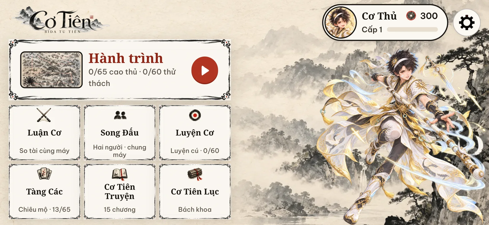 | 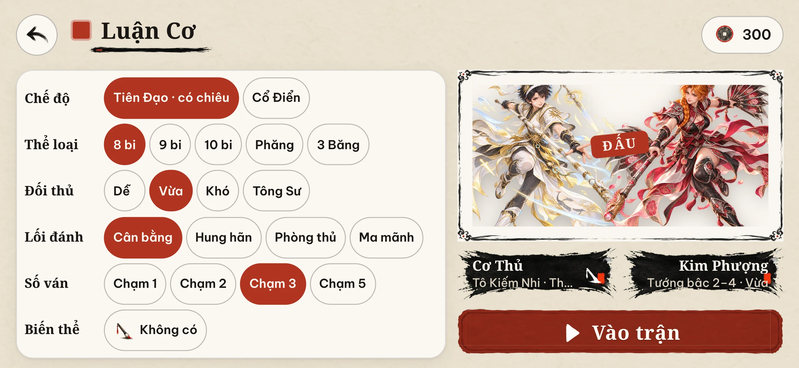 |
| Song Đấu | |
| 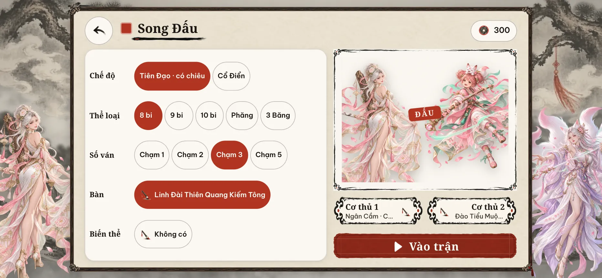 | |
| Trận đấu · mũi tên chỉ lượt | Chiêu thức |
| 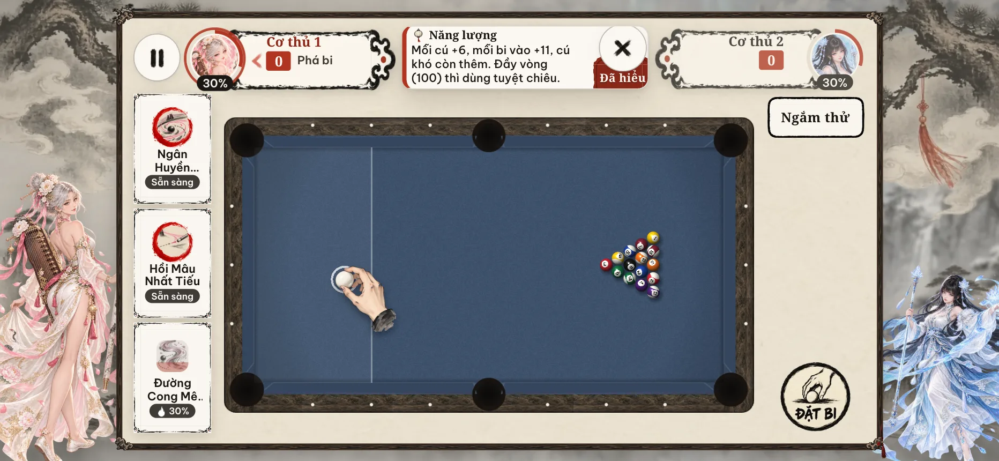 | 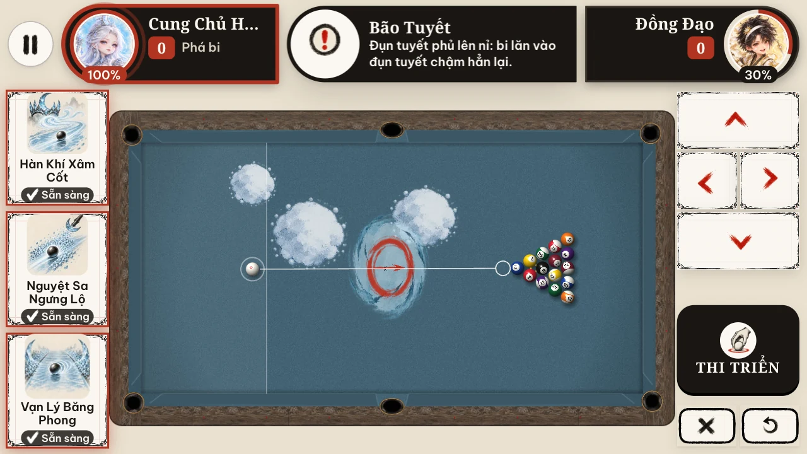 |
| Tuyệt chiêu | Kết liễu |
| 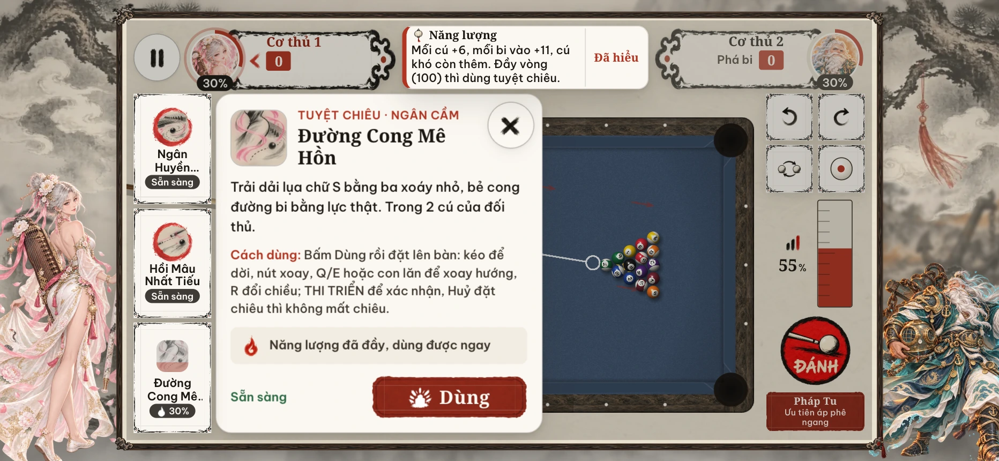 | 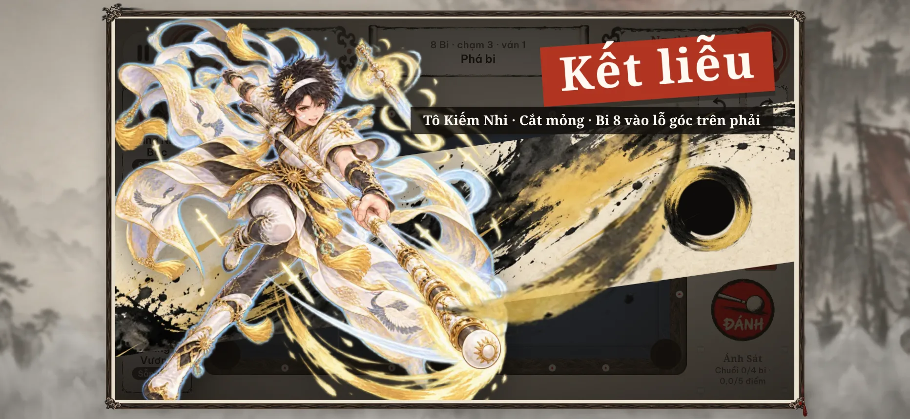 |
| Tạm dừng | Luyện thế · chọn thế |
| 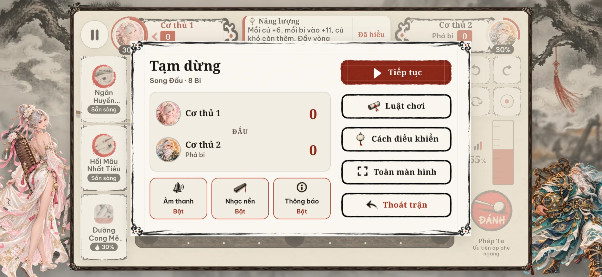 | 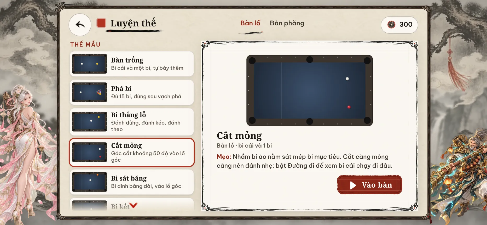 |
| Luyện thế · Đường đi | Tàng Các |
| 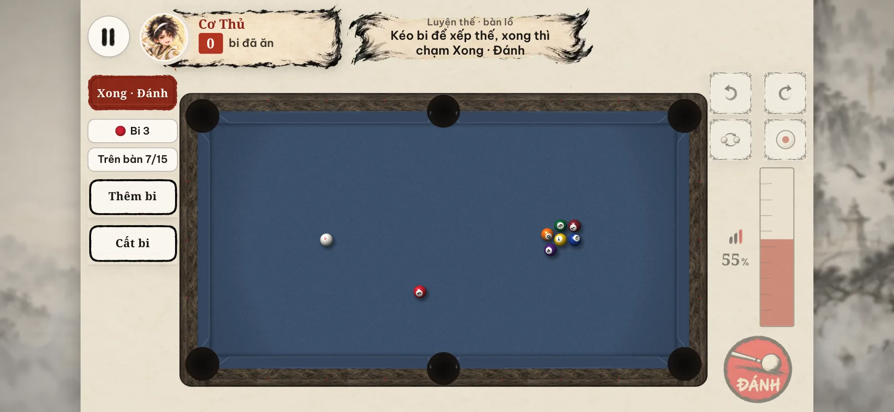 | 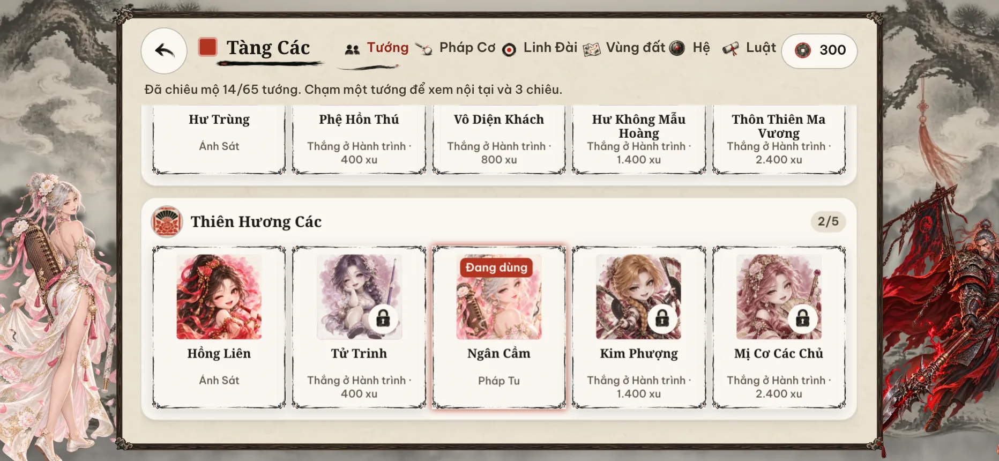 |
| Trang tướng | Cơ Tiên Lục |
| 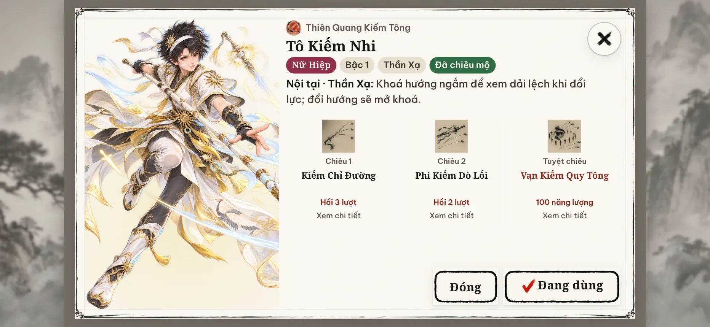 | 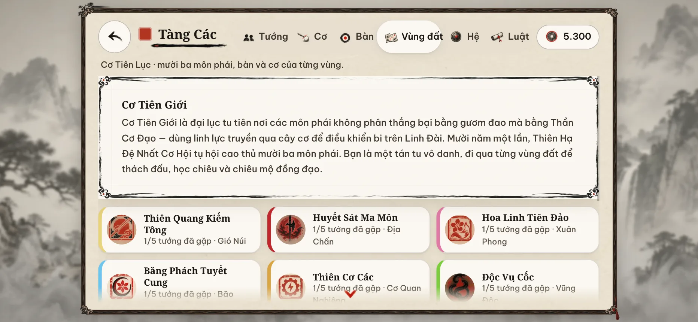 |
| Hành trình | Cơ Tiên Truyện |
| 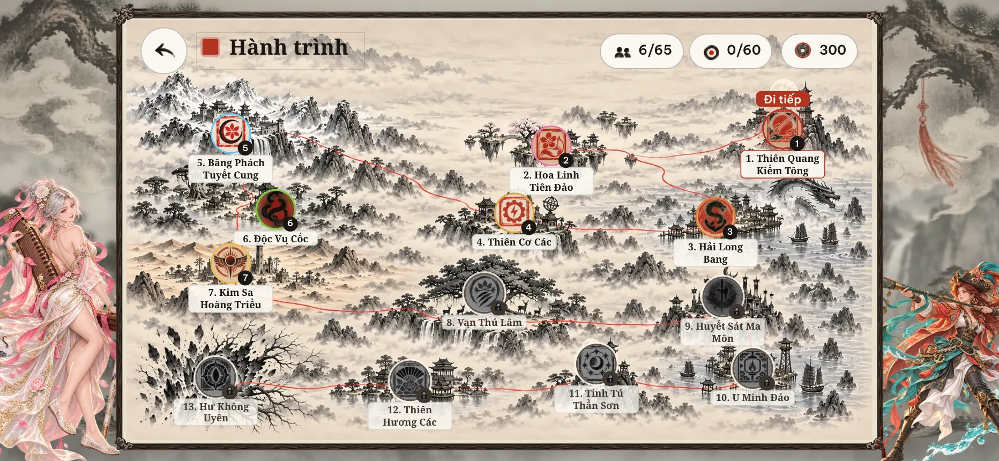 | 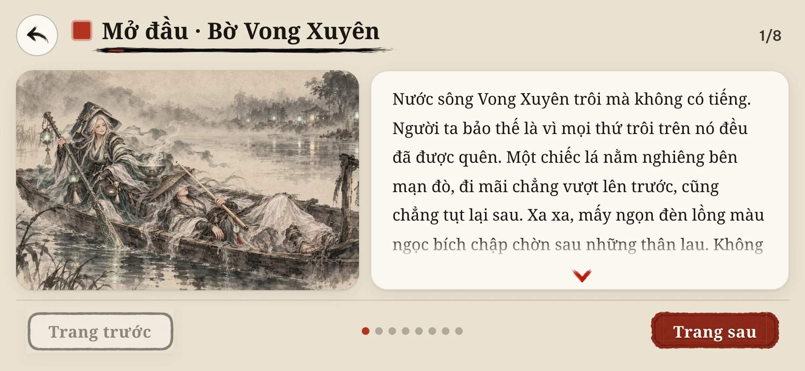 |
| Màn hình lớn | |
| 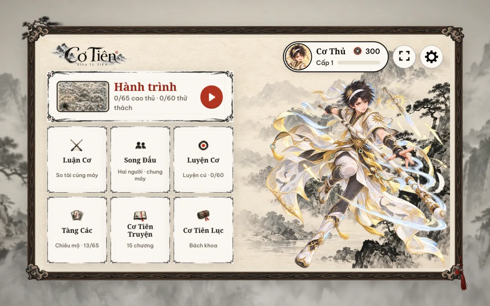 | |

## Phát triển

```bash
npm install
npm run dev            # http://localhost:5173
npm test               # vật lý, luật, AI, thử thách, Luyện thế, chấm điểm cú, gió, tương phản bi–nỉ
npm run build          # typecheck + bản production vào dist/
npm run gen:challenges # sinh lại bộ thử thách (có kiểm chứng lời giải)
```

TypeScript, Vite, PixiJS 8 (WebGL), vite-plugin-pwa. Âm thanh tổng hợp bằng WebAudio, không có file âm
thanh. Tài liệu: [kiến trúc](docs/architecture.md) · [thế giới](docs/world-bible.md) · [cốt truyện](docs/story.md) ·
[đồ hoạ](docs/art-pipeline.md) · [đóng góp](CONTRIBUTING.md) · [AGENTS.md](AGENTS.md) cho AI agent.

## Ý tưởng, nội dung và đồ hoạ đến từ đâu

- **Ý tưởng và định hướng:** tác giả (Nguyễn Đức Anh Khôi) — game bida tu tiên, thế giới Cơ Tiên Giới,
  các lựa chọn về lối chơi, phong cách Thuỷ Mặc, tên game, và mọi quyết định duyệt hay loại nội dung.
- **Nguyên bản:** toàn bộ tên, truyện, môn phái, nhân vật, chiêu thức và tranh là sáng tác riêng cho Cơ Tiên,
  không dùng nội dung của bất kỳ game hay tác phẩm nào khác.
- **Viết nội dung và code:** được phát triển cùng trợ lý AI (Claude, qua Claude Code) theo chỉ đạo của tác
  giả — trợ lý đề xuất và viết, tác giả chọn và duyệt.
- **Đồ hoạ:** toàn bộ tranh được vẽ bằng mô hình sinh ảnh AI (`cx/gpt-6-sol-image` qua
  9router) theo prompt viết riêng cho game, rồi duyệt và chỉnh từng
  tấm. Quy trình, công cụ và tiêu chí duyệt: [docs/art-pipeline.md](docs/art-pipeline.md) và skill
  `.claude/skills/game-art`.

## Giấy phép

Mã nguồn: MIT. Các agent skill bên thứ ba trong `.claude/skills` (trừ `game-art`) thuộc
[gamedev-skills/awesome-gamedev-agent-skills](https://github.com/gamedev-skills/awesome-gamedev-agent-skills),
giấy phép Apache-2.0 — xem `.claude/skills/README.md`.

> Ảnh trong bảng trên được chụp lại từ bản hiện tại ngày 29/10/2026.
